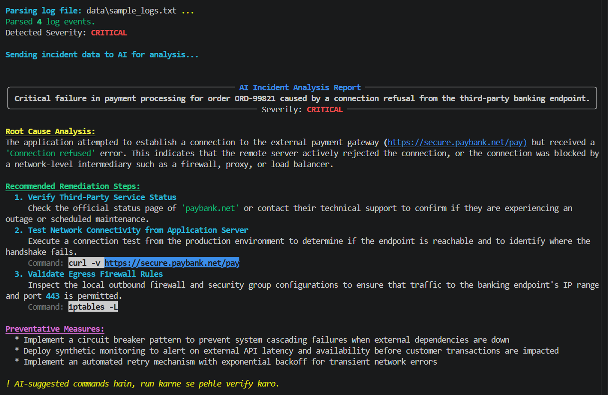

# 🚨 AI Incident Copilot

AI Incident Copilot is a powerful CLI-based tool designed for IT and Network Engineers. It automatically parses complex server logs and uses Large Language Models (LLMs) to provide instant Root Cause Analysis (RCA) and actionable remediation steps.

## 🚀 Key Features

- **Automated Log Parsing:** Handles standard formats, Linux syslog (`Nov 21 14:10:05`), and multi-line Python stack traces.
- **Provider-Agnostic AI:** Works with any OpenAI-compatible API (FreeLLMAPI, OpenAI, Anthropic via proxy, Ollama, LM Studio).
- **Structured Analysis:** Provides a clear breakdown of incident summary, likely root cause, severity, and numbered remediation steps.
- **Mock Mode:** Built-in development mode to test UI/parsing logic without consuming AI tokens.
- **Rich Terminal UI:** Beautiful, color-coded output for quick readability during high-pressure incidents.

---

## 🛠️ Installation

1. **Clone the repository:**
   ```bash
   git clone https://github.com/your-username/ai-incident-copilot.git
   cd ai-incident-copilot
   ```

2. **Set up a virtual environment (Recommended):**
   ```bash
   py -m venv venv
   source venv/Scripts/activate  # On Windows
   ```

3. **Install dependencies:**
   ```bash
   py -m pip install -e ".[dev]"
   ```

---

## ⚙️ Configuration

Create a `.env` file in the root directory by copying the example:

```bash
cp .env.example .env
```

Edit the `.env` file with your provider details:

| Variable | Description | Default / Example |
| :--- | :--- | :--- |
| `LLM_API_KEY` | Your AI provider API key | `sk-xxx...` |
| `LLM_BASE_URL` | API endpoint URL | `http://127.0.0.1:31415/v1` |
| `LLM_MODEL` | Model to use | `auto` or `gpt-4o-mini` |
| `MOCK_MODE` | Use fake AI data (offline) | `true` or `false` |

---

## 📖 Usage

Run the analysis by pointing the tool to any log file:

```bash
py -m incident_copilot.interfaces.cli.main data/sample_logs.txt
```


### Example Command Structure:
`py -m incident_copilot.interfaces.cli.main [LOG_FILE_PATH]`

---

## 📂 Project Structure

```text
ai-incident-copilot/
├── src/
│   └── incident_copilot/
│       ├── ingestion/         # Log parsing logic (Regex, Grouping)
│       ├── ai/                # OpenAI-compatible AI client
│       ├── models/            # Pydantic schemas (Incident, Analysis)
│       ├── interfaces/cli/    # Typer & Rich CLI implementation
│       └── config.py          # Settings management
├── tests/                     # Comprehensive Pytest suite
├── data/                      # Sample log files
└── pyproject.toml             # Project metadata & dependencies
```

---

## ⚠️ Limitations & Safety

- **Human Verification Required:** This tool provides AI-generated suggestions. **Always verify** commands and remediation steps in a safe environment before executing them on production systems.
- **Context Window:** Extremely large log files may exceed the LLM's context limit. It is recommended to provide relevant log segments (around 50-100 lines) for the best results.
- **Format Consistency:** While the parser is robust, non-standard custom log formats might require regex updates in `parser.py`.

---

## 🧪 Testing

Run the full test suite to verify installation:
```bash
py -m pytest -v
```

---
🤖 Generated with [Claude Code](https://claude.com/claude-code)
